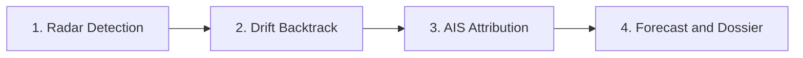
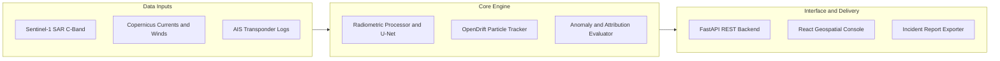

<p align="center">
  
</p>

# Varuna

Varuna is an open-source maritime investigation system that detects marine oil spills from Sentinel-1 satellite radar imagery, backtracks ocean drift to find the original spill location and time, and correlates ship transponder (AIS) data to identify responsible vessels.

---

## The Problem

When satellite radar detects an oil slick in the ocean, hours or even days have usually passed since it was dumped. Wind and ocean currents constantly carry the oil across the surface, meaning the ship that released it is almost never at the location where the slick is spotted. 

Simple satellite image classification only shows where the oil is now, not who dumped it or where it came from. 

Varuna connects satellite computer vision, ocean drift physics, and maritime traffic intelligence to solve this:

1. **Detect the spill:** Processes Sentinel-1 radar imagery, filters out false alarms like low-wind zones and natural algal films, and segments the slick using a U-Net model.
2. **Backtrack ocean drift:** Uses Lagrangian particle modeling driven by ocean currents and wind data to simulate where the oil was released and estimate the release time window.
3. **Identify suspect ships:** Queries vessel transponder (AIS) traffic across the release area and time window, detects suspicious behavior like transponder blackouts or speed drops, and ranks candidate vessels.
4. **Forecast forward spread:** Projects the slick forward up to 48 hours to assess threat to marine reserves, coastal fisheries, and ports.

---

## How It Works



---

## System Architecture



---

## Core Pipeline

### 1. Satellite Radar Processing and Quality Check
- **Radiometric Calibration:** Converts raw Sentinel-1 digital numbers to calibrated decibel backscatter values.
- **Wind and Clutter Gate:** Validates that ambient sea surface winds are between 3 and 12 m/s. Winds below 3 m/s create calm dark patches that look like oil, while winds above 12 m/s disperse oil slicks into the water column.
- **Look-Alike Rejection:** Measures the damping ratio against surrounding sea clutter (typically 6 to 18 dB for petroleum) and boundary gradient sharpness to rule out natural algal blooms, biogenic slicks, and upwelling.

### 2. Deep Learning Slick Segmentation
- **Architecture:** PyTorch 4-level DoubleConv U-Net taking co-polarized (VV) and cross-polarized (VH) channels as input.
- **Loss Function:** Combined Binary Cross-Entropy and Dice Loss to handle severe class imbalance, since oil pixels typically cover less than 2% of a satellite scene.
- **Morphometry:** Calculates slick area in square kilometers, perimeter, length, width, and principal orientation angle using Principal Component Analysis (PCA).

### 3. Lagrangian Particle Drift Modeling
- **Physical Transport:** Oil movement is calculated by combining surface ocean currents with an empirical 3% windage vector, plus stochastic random-walk diffusion ($D = 2.0\text{ m}^2/\text{s}$) across 500 particles.
- **Backward Backtracking:** Reverses time from the satellite sensing timestamp to produce 50%, 75%, and 90% confidence contours around the probable release point, narrowing down the critical discharge time window.
- **Forward Spread:** Projects the slick forward at +6h, +12h, +24h, and +48h horizons to warn authorities about approaching marine protected areas, coastal fisheries, and harbors.

### 4. Vessel Traffic Correlation and Attribution
- **Spatio-Temporal Filtering:** Finds all commercial vessels whose recorded tracks intersect the origin area during the estimated discharge window.
- **Anomaly Detection:** Flags transponder outages longer than 30 minutes while underway, sudden speed drops (often associated with engine maintenance or bilge dumping), and abrupt course changes.
- **Transparent Scoring:** Evaluates candidate vessels using a weighted formula:
  $$\text{Score} = w_{\text{prox}} S_{\text{prox}} + w_{\text{time}} S_{\text{time}} + w_{\text{traj}} S_{\text{traj}} + w_{\text{gap}} S_{\text{gap}} + w_{\text{anom}} S_{\text{anom}}$$
  Weights: Proximity (0.30), Timing (0.25), Trajectory Coherence (0.20), AIS Transmission Gaps (0.15), and Kinematic Anomalies (0.10).

---

## Validation and Benchmarks

The core algorithms have been evaluated on held-out test datasets and benchmark scenarios:

| Task | Test Dataset / Scenario | Metric | Result |
| :--- | :--- | :--- | :--- |
| **SAR Segmentation** | Zenodo SOS Benchmark (808 held-out test patches) | **IoU (Jaccard Index)** | **70.77%** |
| | | **Dice / F1 Score** | **82.88%** |
| | | **Precision** | **80.86%** |
| | | **Recall** | **85.01%** |
| **Drift Origin Recovery** | OpenDrift 20-run Synthetic Test | **90% Contour Containment** | **20 / 20 (100%)** |
| | | **Mean Distance Error** | **0.68 km** |
| **Vessel Attribution** | Multi-Vessel Scenario with Dark Ship Ablation | **Correct Suspect Identified** | **Rank 1 (100%)** |

---

## Project Structure

```text
varuna/
├── apps/
│   ├── api/                  # FastAPI backend routes, schemas, and configurations
│   └── web/                  # React, TypeScript, and Vite geospatial console
├── db/                       # SQLAlchemy models, database setup, and seeder
├── demo/
│   └── incidents/
│       └── incident_001/     # Eastern Mediterranean demonstration incident
│           ├── ais/          # Ship coordinates, vessel info, and detected anomalies
│           ├── annotation/   # Published DARTIS ground truth reference
│           ├── derived/      # GeoJSON particles, contours, and attribution scores
│           ├── environment/  # Copernicus currents and winds NetCDF grids
│           └── satellite/    # Sentinel-1 VV and VH GeoTIFF tiles
├── ml/
│   ├── evaluation/           # Metrics calculation (IoU, Dice, Precision, Recall)
│   ├── lookalike/            # Damping ratio and image quality gate
│   └── segmentation/         # PyTorch U-Net model, dataset loader, and training scripts
├── services/
│   ├── ais/                  # Trajectory interpolation and anomaly detectors
│   ├── assistant/            # Grounded investigation assistant
│   ├── attribution/          # Vessel scoring and priority ranking engine
│   ├── characterisation/     # Slick area, perimeter, and orientation calculations
│   ├── drift/                # OpenDrift Lagrangian dispersion simulation
│   └── reports/              # Incident report generator
├── validation/               # Reproducible benchmark tests and validation summary
└── tests/                    # Integration and unit tests
```

---

## Quickstart

### Prerequisites
- Python 3.10 to 3.12
- Node.js 18+ and npm

### Local Run

```bash
# 1. Clone repository
git clone https://github.com/AryanSharma48/varuna.git
cd varuna

# 2. Setup environment file
cp .env.example .env

# 3. Create virtual environment and install dependencies
python -m venv .venv
source .venv/bin/activate  # On Windows: .venv\Scripts\activate
pip install -r requirements.txt

# 4. Seed database with demonstration incident
python -m db.seed

# 5. Start the backend
uvicorn apps.api.main:app --host 0.0.0.0 --port 8000
```

In a separate terminal, start the web console:

```bash
cd apps/web
npm install
npm run dev
```

Open `http://localhost:5173` in your browser. API docs are available at `http://localhost:8000/docs`.

### Docker Run

```bash
docker-compose up --build
```

### Automated Pipeline Verification

To run the complete 10-step automated pipeline verification covering satellite checks, segmentation, drift backtracking, AIS attribution, and report generation:

```bash
python scripts/verify_workflow.py
```

To run unit tests:

```bash
pytest -v
```

---

## API Endpoints

| Method | Endpoint | Description |
| :--- | :--- | :--- |
| `GET` | `/health` | API health check |
| `GET` | `/api/v1/incidents` | List all incidents |
| `GET` | `/api/v1/incidents/{id}` | Full incident details with satellite and detection data |
| `POST` | `/api/v1/incidents/{id}/ais/query` | Run spatio-temporal vessel query for the incident origin |
| `POST` | `/api/v1/incidents/{id}/ais/replay` | Get time-interpolated vessel positions for animated playback |
| `POST` | `/api/v1/incidents/{id}/forecast-spill` | Run forward drift simulation with wind and current inputs |
| `POST` | `/api/v1/investigation/ask` | Query the grounded AI investigation assistant |
| `POST` | `/api/v1/reports/{id}` | Generate an investigation dossier |
| `GET` | `/api/v1/reports/{report_id}/pdf` | Download printable incident report |

---

## Reference Datasets

- **Satellite Imagery:** Copernicus Sentinel-1 Ground Range Detected (GRD) IW swath scene (`S1B_IW_GRDH_1SDV_20190610T154813_20190610T154838_016636_01F4FD_EE80`).
- **Ground Truth Reference:** DARTIS 2019 Eastern Mediterranean Oil Slick Dataset (Yang and Singha, 2025, PANGAEA, DOI: `10.1594/PANGAEA.980773`, record `ow-0388`).
- **Environmental Data:** Copernicus Marine Service (CMEMS) ocean surface currents and ECMWF ERA5 10m wind fields.
- **Note on Attribution:** The attribution score is an investigative priority ranking intended to help authorities target physical inspections and port checks. It does not constitute legal proof of liability.
